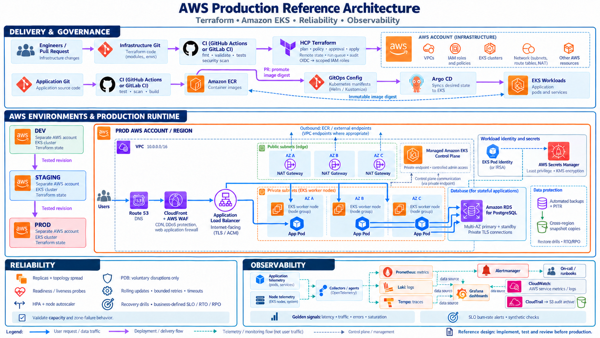
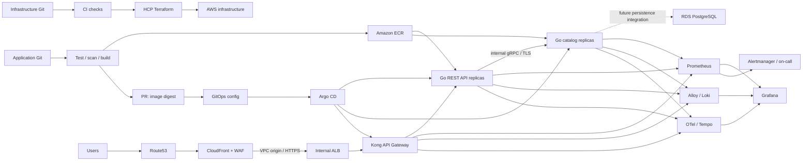

# AWS Platform — monorepo template

One repository for **IaC, applications, reliability, and observability**, with **dev, staging, and prod** environments. The delivery workflow uses **HCP Terraform for infrastructure, GitHub Actions for CI and image builds, and Argo CD for Kubernetes applications**.

```text
.github/workflows/        Validation, image build/scan/push, digest promotion PRs
app/                     Go REST API + gRPC catalog, Protobuf, Docker, integration tests
iac/
  modules/platform/      Three-AZ VPC, NAT per AZ, EKS, ECR, RDS, identity, audit
  modules/edge/          CloudFront VPC origin, WAF, ACM, Route53
  environments/
    dev/{platform,edge}/
    staging/{platform,edge}/
    prod/{platform,edge}/
gitops/
  apps/base/             Deployment, Service, HPA, PDB, NetworkPolicy
  apps/overlays/         dev/staging/prod + Ingress + image digest
  argocd/                AppProject and Application per environment
platform/                Helm values, chart/checksum lock, HCP workspace inventory
observability/           Metrics, logs, traces, alerts, dashboard
reliability/             SLO, load test, incident/recovery runbooks
scripts/                 Bootstrap, chart validation, preflight, image promotion
docs/                    Setup, security, operations, validation status
```

## Architecture



[View the infrastructure diagram](docs/architecture/aws-production-reference.png). The earlier raster illustration does not include Kong; the diagram below shows the current application flow.



AWS Load Balancer Controller creates the ALB from the Ingress; the edge Terraform configuration is applied after the ALB is available. The template uses an **internal ALB + CloudFront VPC origin**, keeping the origin off the public internet. The earlier illustration shows a public origin. Kubernetes Services identify application backends; the ALB targets pod IPs.

## Included components

| Area | Template implementation |
|---|---|
| Network | Three public and three private subnets; NAT per AZ; separate CIDRs per environment |
| EKS | Managed nodes, private endpoint; allowlisted public API access in dev/staging only; prod private-only |
| Identity | EKS access entries; Pod Identity for ALB controller, autoscaler, EBS, Loki, Tempo, Grafana |
| Data | Optional RDS: disabled in dev, single-AZ in staging, Multi-AZ in prod; encryption, managed admin password, PITR |
| Edge | TLS at CloudFront and origin; WAF managed rules; private origin; Route53 |
| API Gateway | Kong OSS DB-less, declarative routes in Git, rate limit per replica, Prometheus and OTel; Admin API disabled |
| App | Go `api` exposes REST; Go `catalog` provides internal gRPC, TLS, health checks, metrics, JSON logs, and distributed traces |
| Reliability | HPA/PDB per service, topology spread, rolling updates, bounded RPC deadline, dependency readiness, graceful draining |
| Observability | Prometheus/Grafana, Loki + Alloy, Tempo + OTel, alert rules, dashboard, CloudWatch datasource |
| Audit | Multi-region CloudTrail + S3 per environment, EKS audit logs |
| Delivery | CI matrix builds two images; ECR per service; digest promotion PRs per service; HCP approval; Argo sync |

Populate the template with your organization's configuration before deployment. No AWS deployment was performed when creating it. The demo application does not use RDS yet; database users, migrations, and application integration are extension points.

## Two Go services

```text
Public REST: GET /api/products/sku-001
       ↓
Kong :8000 (REST routing + rate limit)
       ↓
api :8080  ── GetProduct (gRPC TLS, deadline 800 ms) ──▶ catalog :50051
                                                       internal only
```

Contracts are defined in [catalog.proto](app/api/catalog/v1/catalog.proto) and [OpenAPI](app/api/openapi.yaml). Sample products `sku-001`/`sku-002` are stored in memory. gRPC errors map to HTTP 400/404/502/503/504 without exposing backend details. Trace context propagates across REST and gRPC.

## Run locally

Application prerequisites: Go 1.27.2 or Docker Compose. Python 3.10+ is needed only for platform helpers. Kubernetes/Terraform workflows require kubectl, Helm 3, Terraform >=1.9 <2, and AWS CLI.

```bash
cd app
go test -race ./...
go vet ./...
cd ..
docker compose -f app/compose.yaml up --build
```

In another terminal:

```bash
curl --fail http://localhost:8080/api/products/sku-001
curl --fail http://localhost:8080/api/hello
python scripts/smoke_gateway.py
```

Compose publishes only the Kong proxy on localhost:8080; api and catalog have no host ports. Gateway configuration and operations are documented in [KONG.md](docs/KONG.md). Plaintext gRPC is explicitly enabled for local Compose. Kubernetes uses TLS + NetworkPolicy. See [app/README.md](app/README.md) for running the two binaries without Docker, TLS configuration, health checks, and Protobuf generation.

For platform helpers:

```bash
python -m venv .venv
source .venv/bin/activate
pip install -r scripts/requirements.lock
python scripts/check_template.py
python -m unittest discover -s scripts/tests -v
```

## Deployment sequence

Full instructions: [SETUP.md](docs/SETUP.md).

1. Prepare AWS accounts, domain/hosted zone, HCP organization/workspaces, and cloud identities.
2. Populate the dev **platform** root variables. Review the plan and apply through HCP Terraform.
3. Bootstrap the platform and observability stack, then provision catalog TLS secrets and the API's trusted CA.
4. CI builds, scans, and pushes `api` and `catalog` images to their respective ECR repositories. Each digest promotion PR selects one service and environment.
5. Review the pinned Kong image, then populate both application image digests, repository URL, origin host, certificate ARN, and prefix list ID. Run preflight and apply the Argo project/application.
6. Once the internal ALB is available, populate the **edge** root variables; review the plan and apply.
7. Verify end-to-end HTTPS, telemetry, alert delivery, load tests, and failure/recovery drills. Promote the tested revision to staging/prod with a separate plan for each target.

**Platform and edge state are separate for each environment.** Never reuse a saved plan/state from another environment. A shared module change can affect several workspaces; configure trigger paths and review every affected plan.

## Production controls and template limitations

- The private prod API requires a VPN, private runner, or operator host. GitHub pipelines do not receive kubectl administrator access.
- Configure Argo CD SSO, HCP approvals/policies, GitHub branch/environment protections, on-call receivers, and organization IAM guardrails in the relevant accounts. Bootstrap rejects Argo values without SSO.
- The two stateless example services do not implement user authentication or database integration. Add these according to product requirements before processing customer data.
- Prometheus and Alertmanager each have two replicas; Loki has three. The baseline has **one Tempo replica** and one Grafana replica/PVC. For stronger observability HA, use distributed Tempo/managed tracing, Grafana HA with a shared external database, and Prometheus remote storage/deduplication.
- Collector queues are memory-backed; restarts can lose spans. Set sampling, redaction, retention, and capacity policies for actual log/trace volumes.
- CloudTrail archives are stored in workload accounts. Add a central immutable audit account, WAF/CloudFront/ALB access logs, regional backup replication, and a second-region runtime as required. RDS PITR alone does not provide regional disaster recovery.
- Service versions are pinned in lock files; review security updates regularly. Pin base container image digests and addon versions before production releases. Successfully rendered charts do not establish runtime compatibility with every EKS version.
- Prod RDS deletion protection is enabled; buckets and ECR repositories do not allow force deletion. Follow [OPERATIONS.md](docs/OPERATIONS.md) for decommissioning, snapshots, and data retention.

See [security and identity](docs/SECURITY.md), [runbooks](reliability/runbooks/), [sample SLO](reliability/slo.yaml), and [validation results](docs/VALIDATION.md).

## Customize the repository

This directory is self-contained. To reuse it, create a repository from its contents and update `REPLACE_*` values, domains, account IDs, repository URLs, image digests, CODEOWNERS, and HCP settings. `.generated/`, credentials, state, and personal tfvars are excluded from version control.

## Official references

- [HCP Terraform dynamic credentials](https://developer.hashicorp.com/terraform/cloud-docs/dynamic-provider-credentials)
- [EKS Pod Identity](https://docs.aws.amazon.com/eks/latest/userguide/pod-id-association.html)
- [AWS Load Balancer Controller](https://kubernetes-sigs.github.io/aws-load-balancer-controller/latest/deploy/installation/)
- [CloudFront VPC origins](https://docs.aws.amazon.com/AmazonCloudFront/latest/DeveloperGuide/private-content-vpc-origins.html)
- [Argo CD GitOps](https://argo-cd.readthedocs.io/en/stable/)
- [Kong DB-less configuration](https://developer.konghq.com/gateway/db-less-mode/)
- [Kong Prometheus plugin](https://developer.konghq.com/plugins/prometheus/)
