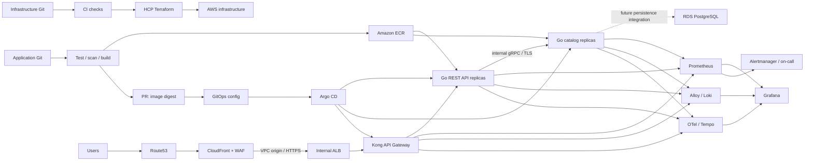

# AWS Platform — monorepo template

Satu repository untuk **IaC, aplikasi, reliability, dan observability**, dengan environment **dev, staging, prod**. Template mengikuti alur **HCP Terraform untuk infrastruktur, GitHub Actions untuk CI/build, dan Argo CD untuk aplikasi Kubernetes**.

```text
.github/workflows/        Validasi, build/scan/push image, PR promosi digest
app/                     Go REST API + gRPC catalog, Protobuf, Docker, integration tests
iac/
  modules/platform/      VPC 3 AZ, NAT per AZ, EKS, ECR, RDS, identity, audit
  modules/edge/          CloudFront VPC origin, WAF, ACM, Route53
  environments/
    dev/{platform,edge}/
    staging/{platform,edge}/
    prod/{platform,edge}/
gitops/
  apps/base/             Deployment, Service, HPA, PDB, NetworkPolicy
  apps/overlays/         dev/staging/prod + Ingress + image digest
  argocd/                AppProject dan Application per environment
platform/                Helm values, chart/checksum lock, HCP workspace inventory
observability/           Metrics, logs, traces, alerts, dashboard
reliability/             SLO, load test, incident/recovery runbooks
scripts/                 Bootstrap, chart validation, preflight, image promotion
docs/                    Setup, security, operasi, status validasi
```

## Arsitektur


[Perbesar gambar infrastruktur](docs/architecture/aws-production-reference.png). Ilustrasi raster sebelumnya belum memuat Kong; diagram di bawah menunjukkan alur aplikasi terbaru.



ALB dibuat AWS Load Balancer Controller melalui Ingress; edge Terraform dibuat sesudah ALB tersedia. Berbeda dari ilustrasi public-origin sebelumnya, template memakai **internal ALB + CloudFront VPC origin** sehingga origin tidak terbuka langsung ke internet. Kubernetes Service mewakili backend aplikasi; ALB memakai IP target pod.

## Yang tersedia

| Bagian | Implementasi template |
|---|---|
| Network | 3 public + 3 private subnet; NAT per AZ; CIDR berbeda per environment |
| EKS | Managed nodes, private endpoint, API public hanya dev/staging dengan allowlist; prod private-only |
| Identity | EKS access entries, Pod Identity untuk ALB controller, autoscaler, EBS, Loki, Tempo, Grafana |
| Data | RDS opsional: dev off, staging single-AZ, prod Multi-AZ; encrypted, managed admin password, PITR |
| Edge | TLS di CloudFront dan origin; WAF managed rules; private origin; Route53 |
| API Gateway | Kong OSS DB-less, declarative routes di Git, rate limit per replica, Prometheus dan OTel; Admin API off |
| App | Go `api` menyediakan REST; Go `catalog` menyediakan gRPC internal, TLS, health, metrics, JSON logs, dan distributed traces |
| Reliability | HPA/PDB per service, topology spread, rolling updates, bounded RPC deadline, dependency readiness, graceful drain |
| Observability | Prometheus/Grafana, Loki + Alloy, Tempo + OTel, alert rules, dashboard, CloudWatch datasource |
| Audit | CloudTrail multi-region + S3 per environment, EKS audit logs |
| Delivery | CI matrix membangun dua image; ECR per service; promosi digest per service lewat PR; HCP approval; Argo sync |

Template ini perlu diisi dengan konfigurasi organisasi sebelum deployment. Tidak ada deployment AWS yang dijalankan saat pembuatan. RDS belum dipakai aplikasi demo; database user, migrasi, dan integrasi aplikasi adalah extension point.

## Dua service Go

```text
Public REST: GET /api/products/sku-001
       ↓
Kong :8000 (REST routing + rate limit)
       ↓
api :8080  ── GetProduct (gRPC TLS, deadline 800 ms) ──▶ catalog :50051
                                                       internal only
```

Kontrak ada di [catalog.proto](app/api/catalog/v1/catalog.proto) dan [OpenAPI](app/api/openapi.yaml). Data contoh `sku-001`/`sku-002` masih in-memory. Error gRPC dipetakan ke HTTP 400/404/502/503/504 tanpa membocorkan detail backend. Trace context dipropagasikan lintas REST dan gRPC.

## Mulai lokal

Prasyarat aplikasi: Go 1.27.2 atau Docker Compose. Python 3.10+ hanya diperlukan helper platform. Kubernetes/Terraform membutuhkan kubectl, Helm 3, Terraform >=1.9 <2, dan AWS CLI.

```bash
cd app
go test -race ./...
go vet ./...
cd ..
docker compose -f app/compose.yaml up --build
```

Di terminal lain:

```bash
curl --fail http://localhost:8080/api/products/sku-001
curl --fail http://localhost:8080/api/hello
python scripts/smoke_gateway.py
```

Compose hanya mempublish proxy Kong ke localhost:8080; api dan catalog tidak memiliki host port. Konfigurasi dan operasi gateway ada di [KONG.md](docs/KONG.md). Plaintext gRPC diizinkan eksplisit untuk Compose lokal. Kubernetes memakai TLS + NetworkPolicy. Panduan menjalankan dua binary tanpa Docker, konfigurasi TLS, health, dan Protobuf generation ada di [app/README.md](app/README.md).

Untuk helper platform:

```bash
python -m venv .venv
source .venv/bin/activate
pip install -r scripts/requirements.lock
python scripts/check_template.py
python -m unittest discover -s scripts/tests -v
```

## Urutan deployment

Panduan lengkap: [SETUP.md](docs/SETUP.md).

1. Siapkan akun AWS, domain/hosted zone, HCP organization/workspaces, dan cloud identities.
2. Isi variables root **platform** untuk dev. Review plan dan apply melalui HCP Terraform.
3. Operator melakukan bootstrap platform/observability, lalu menyediakan TLS secrets catalog dan CA untuk API.
4. CI membangun, memindai, dan push image `api` serta `catalog` ke ECR masing-masing. Promosi digest memilih satu service dan environment per PR.
5. Review image Kong yang dikunci versinya, lalu isi dua image digest aplikasi, repo URL, origin host, certificate ARN, prefix list ID. Jalankan preflight, apply Argo project/application.
6. Setelah internal ALB tersedia, isi variables root **edge**; review plan dan apply.
7. Verifikasi HTTPS end-to-end, telemetry, notifikasi alert, load test, dan failure/recovery drill. Promosikan revisi yang diuji ke staging/prod dengan plan masing-masing.

**State platform dan edge terpisah per environment.** Jangan memakai saved plan/state dari environment lain. Satu perubahan shared module dapat memengaruhi beberapa workspace; configure trigger paths dan review semua plan terdampak.

## Kontrol produksi dan batas template

- Prod API private membutuhkan VPN/private runner/operator host. Pipeline GitHub tidak diberi akses kubectl admin.
- SSO Argo CD, HCP approval/policy, GitHub branch/environment protections, on-call receiver, dan organization IAM guardrails harus dikonfigurasi di akun masing-masing. Bootstrap menolak Argo values tanpa SSO.
- Dua service contoh stateless ini belum memiliki autentikasi pengguna atau database integration. Tambahkan sesuai kebutuhan produk sebelum memproses data pelanggan.
- Prometheus dan Alertmanager memiliki dua replica; Loki tiga. **Tempo satu replica** dan Grafana single replica/PVC dalam baseline ini. Untuk kebutuhan observability HA yang lebih tinggi, gunakan Tempo distributed/managed tracing, Grafana HA dengan shared external DB, dan Prometheus remote storage/deduplication.
- Collector queue memory-backed; restart dapat kehilangan span. Logs/traces memerlukan kebijakan sampling, redaction, retention, serta kapasitas yang sesuai data nyata.
- CloudTrail archive ada di akun workload; central immutable audit account, WAF/CloudFront/ALB access logs, dan regional backup replication/second-region runtime perlu dilengkapi sesuai kebutuhan. RDS PITR tidak memberikan regional disaster recovery sendiri.
- Service versions dikunci pada lock files, tetapi review security updates secara berkala. Pin base container image digest dan addon versions sebelum release produksi. Charts adalah versi yang berhasil dirender, bukan bukti kompatibilitas runtime dengan seluruh versi EKS.
- Prod RDS deletion protection aktif; bucket dan ECR tidak force-delete. Decommission mengikuti [OPERATIONS.md](docs/OPERATIONS.md), termasuk snapshot dan retensi data.

Lihat [security dan identity](docs/SECURITY.md), [runbooks](reliability/runbooks/), [SLO contoh](reliability/slo.yaml), dan [hasil validasi](docs/VALIDATION.md).

## Jadikan repository sendiri

Folder ini berdiri sendiri. Buat repository dari isinya, lalu ganti `REPLACE_*`, domain, ID akun, URL repo, image digest, CODEOWNERS, dan HCP settings. Direktori `.generated/`, credentials, state, dan tfvars personal tidak ikut version control.

## Referensi resmi

- [HCP Terraform dynamic credentials](https://developer.hashicorp.com/terraform/cloud-docs/dynamic-provider-credentials)
- [EKS Pod Identity](https://docs.aws.amazon.com/eks/latest/userguide/pod-id-association.html)
- [AWS Load Balancer Controller](https://kubernetes-sigs.github.io/aws-load-balancer-controller/latest/deploy/installation/)
- [CloudFront VPC origins](https://docs.aws.amazon.com/AmazonCloudFront/latest/DeveloperGuide/private-content-vpc-origins.html)
- [Argo CD GitOps](https://argo-cd.readthedocs.io/en/stable/)

- [Kong DB-less configuration](https://developer.konghq.com/gateway/db-less-mode/)
- [Kong Prometheus plugin](https://developer.konghq.com/plugins/prometheus/)
